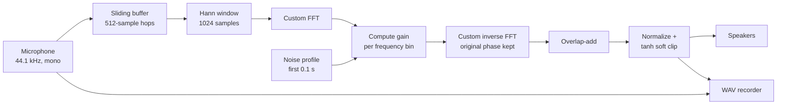

# Real-Time Noise Reduction with a From-Scratch FFT

A real-time audio noise reduction tool in Python. It listens to the microphone, learns what the background noise sounds like, removes it in the frequency domain, and plays the cleaned audio back live. Both the raw and the cleaned audio can be recorded to WAV files for side-by-side comparison.

The Fast Fourier Transform is **implemented from scratch** (iterative radix-2 Cooley–Tukey) instead of calling `numpy.fft`, to show how the algorithm works end to end.

---

## Features

- **Live processing** – microphone in, cleaned audio out, using PyAudio callback streams.
- **Custom FFT / inverse FFT** – iterative radix-2 Cooley–Tukey with bit-reversal permutation; the inverse FFT reuses the forward FFT through the conjugation trick.
- **Automatic noise profiling** – the first 0.1 seconds of input are used to build an average noise spectrum.
- **Spectral noise suppression** – a Wiener-style gain with over-subtraction, a second refinement pass, frequency-dependent weighting and gain smoothing over time.
- **Overlap-add reconstruction** – Hann window with 50% overlap, so frames join smoothly without clicks.
- **Output protection** – level normalization and `tanh` soft clipping to prevent harsh distortion.
- **A/B recording** – press `R` to start and `S` to stop; raw and cleaned audio are saved as separate WAV files.

## How It Works



### 1. Noise profile

When the program starts, it collects 0.1 seconds of audio (this should be background noise only, so stay quiet for a moment). Each 1024-sample frame is windowed and transformed, and the magnitude spectra are averaged into a single **noise spectrum**.

### 2. Per-frame suppression

For every new block of audio:

1. A 1024-sample window is taken from a sliding buffer and multiplied by a Hann window.
2. The FFT gives a magnitude and a phase for each frequency bin. Only the first half of the spectrum (`N/2 + 1` bins) is processed, because the input is real.
3. The noise estimate is boosted by an **over-subtraction factor (3.5)** and by **frequency weights**:

   | Frequency band | Weight | Typical noise there |
   |---|---|---|
   | < 500 Hz | 2.0 | hum, rumble, fan noise – suppressed the most |
   | 500 – 2000 Hz | 1.5 | moderate boost; this band also carries most voice energy |
   | 2000 – 4000 Hz | 1.0 | no extra boost, to protect speech clarity |
   | ≥ 4000 Hz | 1.8 | hiss |

4. A **Wiener-style gain** is calculated from the per-bin signal-to-noise ratio:
   `gain = SNR / (SNR + 2)`.
   Bins that are mostly noise get a gain close to 0; bins with strong signal stay close to 1.
5. A **second pass** recalculates the SNR on the already-attenuated spectrum and multiplies in a second gain. This removes leftover noise more aggressively.
6. A **minimum gain / spectral floor** keeps the gain from reaching exactly zero, which reduces the "musical noise" artifacts typical of spectral subtraction.
7. The gain is **smoothed over time** (`0.85 · previous + 0.15 · current`) so it does not jump between frames.
8. The new magnitudes are combined with the **original phase**, the full symmetric spectrum is rebuilt, and the inverse FFT turns it back into a time signal.
9. **Overlap-add** with the previous frame produces 512 output samples.

### 3. Output

The result is normalized and passed through `tanh` soft clipping, then queued for the output stream. A short queue (8 blocks max) keeps latency bounded: if output falls behind, old blocks are dropped instead of building delay.

## Tech Stack

- **Python 3**
- **NumPy** – array math (the FFT itself is custom)
- **PyAudio** – real-time audio input/output streams
- **wave** (standard library) – saving WAV files

## Project Structure

```
.
├── main.py            # NoiseReducer: audio streams, noise profile, suppression, overlap-add, CLI
├── fft.py             # CustomFFT: radix-2 FFT, bit-reversal, inverse FFT
└── audio_recorder.py  # AudioRecorder: saves raw and cleaned audio as 16-bit WAV files
```

## Getting Started

### Requirements

- Python 3.9+
- A microphone and speakers/headphones (**use headphones** – otherwise the speaker output goes back into the microphone and causes feedback)
- PortAudio (needed by PyAudio)
  - macOS: `brew install portaudio`
  - Ubuntu/Debian: `sudo apt install portaudio19-dev`
  - Windows: usually not needed; `pip install pyaudio` installs a prebuilt wheel

### Install and run

```bash
pip install numpy pyaudio
python main.py
```

Stay quiet for the first moment while the noise profile is created ("Gürültü profili hazır" is printed when it is ready). Then speak and listen to the cleaned audio in your headphones.

### Controls

Type a key and press Enter:

| Key | Action |
|---|---|
| `R` | Start recording |
| `S` | Stop recording and save files |
| `Q` | Quit |

Recordings are saved to the `recordings/` folder:

```
recordings/raw_YYYYMMDD_HHMMSS.wav     # original microphone input
recordings/clean_YYYYMMDD_HHMMSS.wav   # noise-reduced output
```

## Configuration

All parameters are set in `NoiseReducer.__init__` in `main.py`:

| Parameter | Default | Effect |
|---|---|---|
| `RATE` | 44100 | Sample rate (Hz) |
| `CHUNK` | 1024 | FFT size (must be a power of 2) |
| `calibration_time` | 0.1 | Seconds of audio used for the noise profile |
| `over_subtraction` | 3.5 | Higher = more noise removed, but more voice distortion |
| `min_gain` | 0.01 | Lowest gain allowed in each pass |
| `spectral_floor` | 0.005 | Absolute lowest final gain |
| `multi_pass` | True | Enables the second suppression pass |
| `second_pass_factor` | 1.5 | Strength of the second pass |
| `gain_smoothing` | 0.85 | Higher = smoother but slower to react |

## Limitations and Future Work

- **Static noise profile:** the noise is measured only once at startup. If the noise changes (for example, a fan turns on later), the profile becomes outdated. A voice activity detector could update the profile automatically during silent moments.
- **Pure-Python FFT speed:** one 1024-point transform takes a few milliseconds in pure Python, and each block needs two (forward and inverse). This is close to the 11.6 ms block time at 44.1 kHz, so slower machines may produce gaps. Swapping in `numpy.fft.rfft` / `irfft` is a one-line change that makes it many times faster; the custom version is kept for learning purposes.
- **Stationary noise works best:** steady noises such as fans, hum and hiss are removed well; sudden noises such as keyboard clicks or other people talking are much harder for spectral methods.
- **Fixed parameters:** the gain settings are tuned by ear. A small settings file or command-line flags would make them easier to experiment with.

## Author

**Ahmet Özgül** – [GitHub](https://github.com/AhmetOzgul)
